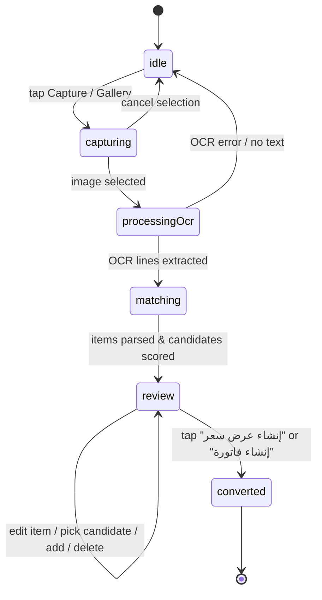

# Data Model: Offline Arabic OCR & Plumbing Requisition Parsing

**Feature**: `005-scan-ocr-handwriting`  
**Date**: 2026-10-13  
**Status**: Completed  

---

## 1. Domain Entities

### `ScannedLineItem`
Represents an individual extracted and structured line from the handwritten slip.

| Field | Type | Description | Validation |
|-------|------|-------------|------------|
| `id` | `String` | Unique client-side UUID for the scanned item | Non-empty |
| `lineNumber` | `int` | 1-based line index in the scanned slip | $\ge 1$ |
| `rawText` | `String` | Raw recognized Arabic/digit text from OCR engine | Non-empty |
| `normalizedText` | `String` | Normalized search phrase (digits, fractions, synonyms) | Non-empty |
| `extractedQuantity` | `double` | Parsed quantity (e.g. 5, 10, 2.5) | $> 0$, defaults to 1.0 |
| `extractedUnit` | `String` | Parsed unit (`قطعة`, `متر`, `لفة`, etc.) | Defaults to `قطعة` |
| `matchedProduct` | `CatalogCandidateMatch?` | Preselected catalog product (if confident) | Optional |
| `candidates` | `List<CatalogCandidateMatch>` | Top matching catalog candidates (up to 5) | Max 5, sorted desc by score |
| `isCustom` | `bool` | True if user or engine marked as custom item | Boolean |
| `customUnitPricePiastres` | `int` | Unit price in piastres if custom item | $\ge 0$ |
| `reviewStatus` | `ScanItemStatus` | Review status: `verified`, `needsReview`, `unmatched` | Enum |

### `CatalogCandidateMatch`
Represents a matching candidate product from the local Drift SQLite catalog.

| Field | Type | Description | Validation |
|-------|------|-------------|------------|
| `productId` | `String` | Unique product ID in local database | Non-empty UUID |
| `productCode` | `String` | Merchant SKU / product code | Non-empty |
| `productName` | `String` | Arabic product title | Non-empty |
| `unitPricePiastres` | `int` | Current selling price in piastres | $\ge 0$ |
| `matchScore` | `double` | Matching confidence score | $0.0 \le \text{score} \le 1.0$ |
| `matchReason` | `String` | Descriptive explanation of match | Non-empty |

### `ScanSession`
Represents an active or completed OCR scanning session.

| Field | Type | Description | Validation |
|-------|------|-------------|------------|
| `sessionId` | `String` | Unique session UUID | Non-empty |
| `imagePath` | `String?` | Local cached file path of the captured photo | Valid local path |
| `scannedAt` | `DateTime` | Timestamp of scan initiation | Non-null |
| `items` | `List<ScannedLineItem>` | Extracted, parsed, and matched line items | Ordered by `lineNumber` |
| `status` | `ScanSessionStatus` | Current lifecycle stage | Enum |

---

## 2. Enums

### `ScanItemStatus`
- `verified`: Match score $\ge 0.85$ and unambiguous; preselected and ready for export.
- `needsReview`: Match score $< 0.85$ or multiple competing candidates; flagged with warning indicator.
- `unmatched`: No catalog candidates with score $\ge 0.40$; treated as custom item.

### `ScanSessionStatus`
- `idle`: Ready to capture or select image.
- `capturing`: Camera or image picker open.
- `processingOcr`: OCR engine extracting lines.
- `matching`: Normalizer, parser, and catalog matcher executing.
- `review`: Results ready for merchant interactive review and adjustments.
- `converted`: Exported to quotation or invoice draft.

---

## 3. State Transitions

